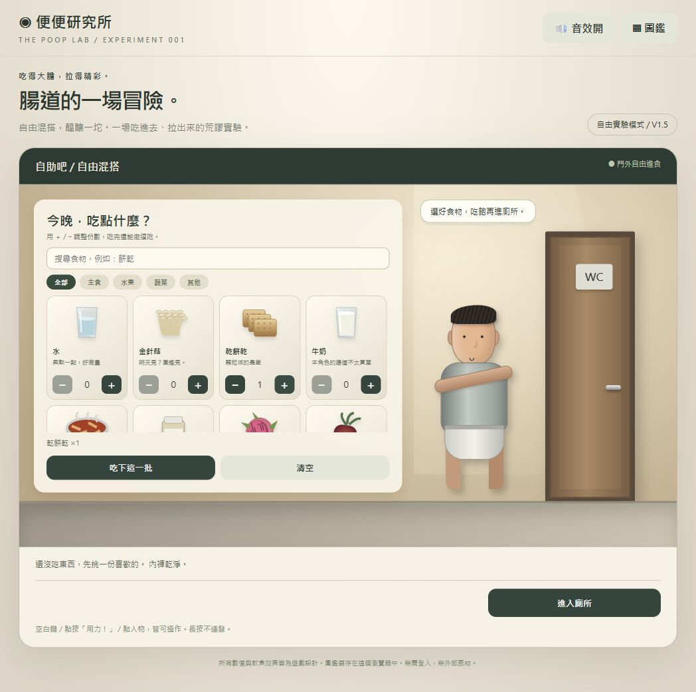
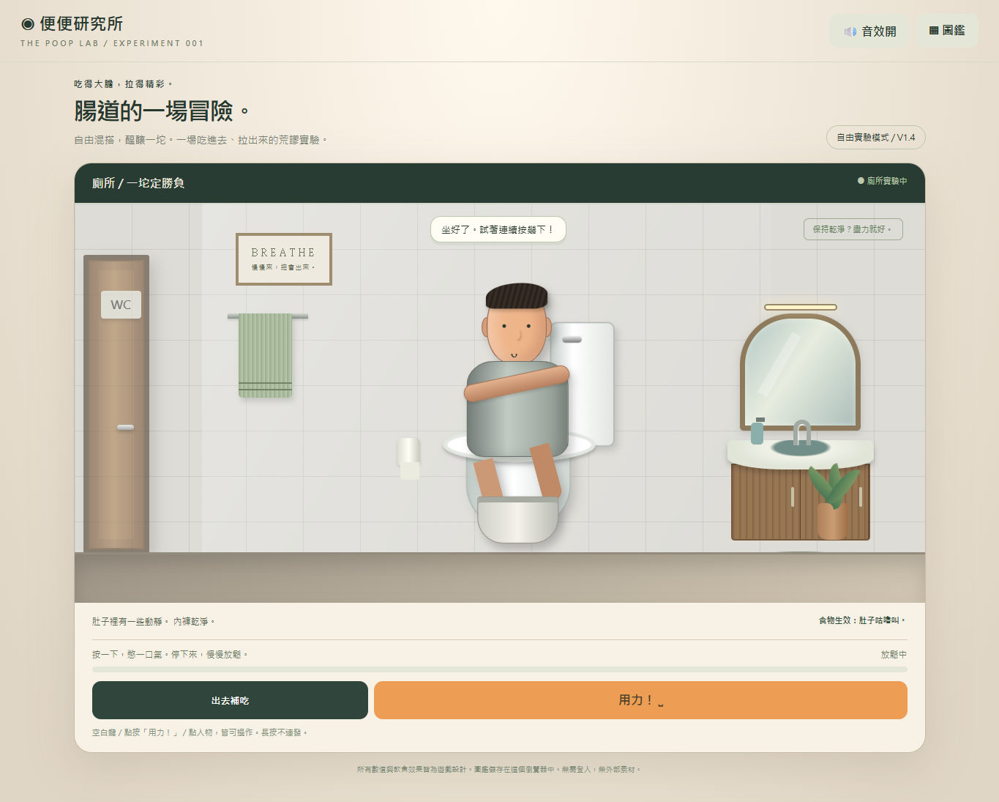
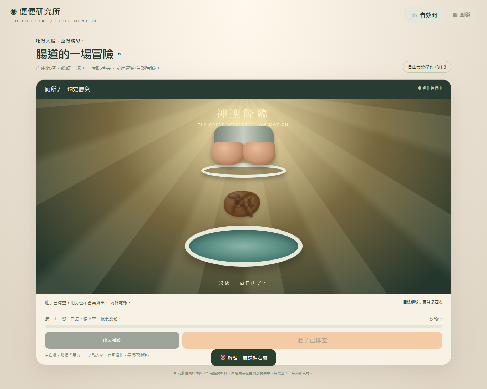

# 便便研究所 💩

**自由混搭，醞釀一坨。** 一款透過 Vibe Coding 製作的搞笑互動網頁遊戲：在自助吧選餐、進廁所用力，再欣賞自己的作品神聖地落進水中。

👉 **[立即遊玩](https://poxuan1110.github.io/poop-lab/)**  
📋 **[完整規格書](SPEC.md)**

## 作品畫面

### 自助吧



### 廁所



### 神聖降臨



## 怎麼玩

1. 在自助吧搜尋或分類瀏覽食物，用「＋／−」調整份數。
2. 按「吃下這一批」，等待肚子叫；也可以繼續選餐、分批進食。
3. 按「進入廁所」，觀看開門、走入及坐下動畫。
4. **連按空白鍵、點「用力！」或點人物**。每次按壓增加一次力道，停止後會慢慢下降，長按不會自動連發。
5. 如果卡住，可以按「出去補吃」，原本的推進進度會保留。
6. 成功後，所有食物合成一坨便便，播放慢動作落水與神聖音樂，接著自動結算。
7. 查看新成就與本局食譜，按「再吃一輪」重玩。

畫面只透過表情、汗水、動作、文字與不帶數字的力道條提供回饋。電腦與手機皆可操作，右上角可切換音效與查看圖鑑。

## 主要功能

| 功能 | 內容 |
| --- | --- |
| 21 種食物 | 主食、水果、蔬菜及其他品項，可搜尋、增減及混搭 |
| 混色與質地 | 依食物份量混色，影響軟硬、總量、菇絲與稀便等結果 |
| 按壓用力 | 力道隨按壓增加、停止後下降；乾硬便便也能透過持續操作排出 |
| 單一場景切換 | 自助吧與廁所共用同一舞台，每次進出播放完整動畫 |
| 中途補吃 | 尚未排出時可以離開，保留進度並改變食物組合 |
| 失控與污漬 | 急迫感過高先警告，拖延可能失控；排到一半離開也可能沾污 |
| 慢動作排出 | 便便清楚穿過空中，落水時出現水波與水花，搭配神聖感音樂 |
| 33 項成就 | 行為 17 項、便便 16 項，只顯示本局首次解鎖項目 |
| 三類圖鑑 | 行為、便便與 21 種食物收藏，吃過一次即可收錄食物 |
| 本局報告 | 自動結算、食譜查看、成果重開與重玩 |
| 音效 | 咀嚼、放屁、開門、呻吟、肚子叫、落水與神聖和弦，支援靜音 |
| 本機保存 | 瀏覽器保存圖鑑與音效偏好，切換背景分頁會暫停 |

**所有飲食效果與數值均為誇張的遊戲設定。** 食物影響的是遊戲角色，並非真實飲食或用藥建議。

## 食物清單

- **主食**：白飯、湯麵、吐司、乾餅乾、墨魚義大利麵、烤地瓜。
- **水果**：香蕉、蘋果、紅心火龍果、藍莓。
- **蔬菜**：金針菇、菠菜、花椰菜、甜菜根。
- **其他**：水、牛奶、咖啡、水煮蛋、雞胸肉、麻辣火鍋、瀉藥（遊戲道具）。

不同染色食物會依份量混合：例如紅紫色火龍果與深藍紫色藍莓形成紫色調，墨魚義大利麵則把混合色往墨黑色拉。最後一次排出全部，食量越多，便便越大。

## 技術與執行

遊戲本體是單一 **[index.html](index.html)**，HTML、CSS、JavaScript、SVG 插畫與 Web Audio 合成音效都內嵌在檔案中，沒有外部素材或套件依賴，不需要登入或後端伺服器。

- 直接用瀏覽器開啟 `index.html` 即可遊玩。
- 公開版本使用 **GitHub Pages**，從 `main` 分支根目錄發布。
- 圖鑑與音效偏好使用 `localStorage`，紀錄限於目前瀏覽器與網站來源，不會跨裝置同步。

```text
poop-lab/
├── index.html          # 完整遊戲
├── README.md           # 作品介紹
├── SPEC.md             # 完整規格書
├── buffet.png          # 自助吧截圖
├── bathroom.png        # 廁所截圖
└── descent.png         # 慢動作截圖
```

截圖與文件是作品介紹的輔助檔案；遊戲執行仍只需要 `index.html`。

## Vibe Coding 與修改過程

先提出「食物影響便便、用力排出、中途補吃」的想法，再與 AI 討論成規格、製作第一版，透過試玩持續調整：

1. 改為依食物份量混色，以及連續按壓、停止後下降的用力方式。
2. 修正火龍果誤用西瓜圖示，加入食物份數減少功能。
3. 將自助吧與廁所改成單一舞台切換，補上開門與進出動畫。
4. 將多次排出改成所有食物合成一坨、排完自動結算。
5. 加入神聖音樂與慢動作，修正便便被樣式固定在起點、沒有真正下落的問題。
6. 擴充日常食物、成就與食物图鑑，加入洗手台、鏡子、毛巾與植栽。
7. 降低乾硬便便门檻，實測 24 份乾餅乾也可成功排出。
8. 加入搜尋、分類、本局食譜、靜音保存，並改善手機與鍵盤操作。

## 已完成的驗證

- 食物增減、搜尋、分類、消化、中途補吃與場景切換。
- 24 份乾餅乾一次排出乾硬便便；肚子清空後不會重複產生便便。
- 三個動畫時間點的便便位置確實持續下降，落水後才結算。
- 動畫操作鎖定、成就去重、圖鑑與音效偏好保存。
- 食譜查看、成果重開、重玩與手機版橫向不溢出。
- GitHub Pages 已部署，公開網站可載入並操作。

## 作業說明

本作品對應「用 Vibe Coding 做出一個互動網頁」作業。規格、實作與調整紀錄可參考本 README 及 [SPEC.md](SPEC.md)。繳交時仍需依課程要求，在文字輸入區提供**網站連結、介面截圖及規格文字說明**。

